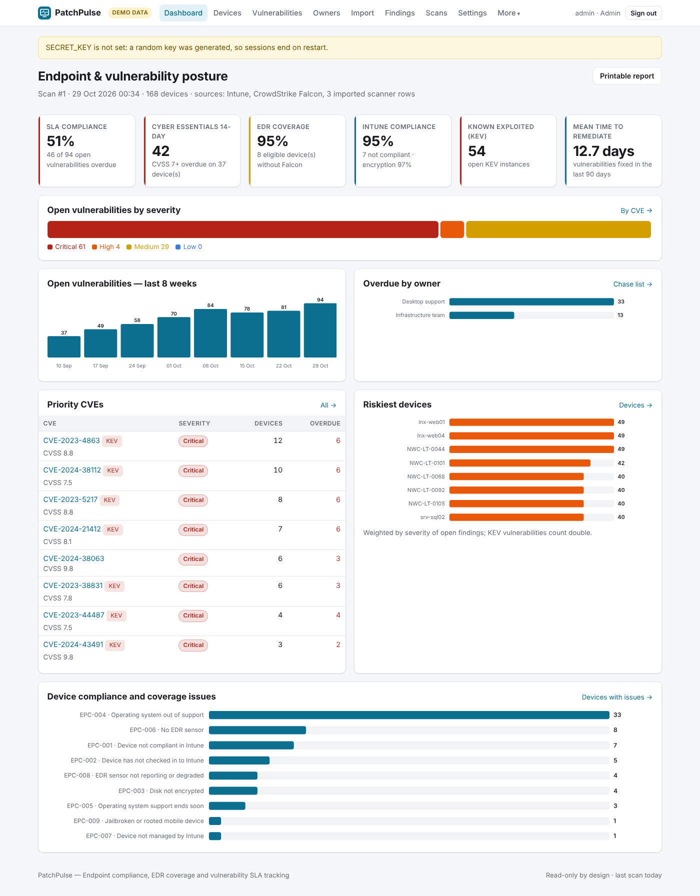
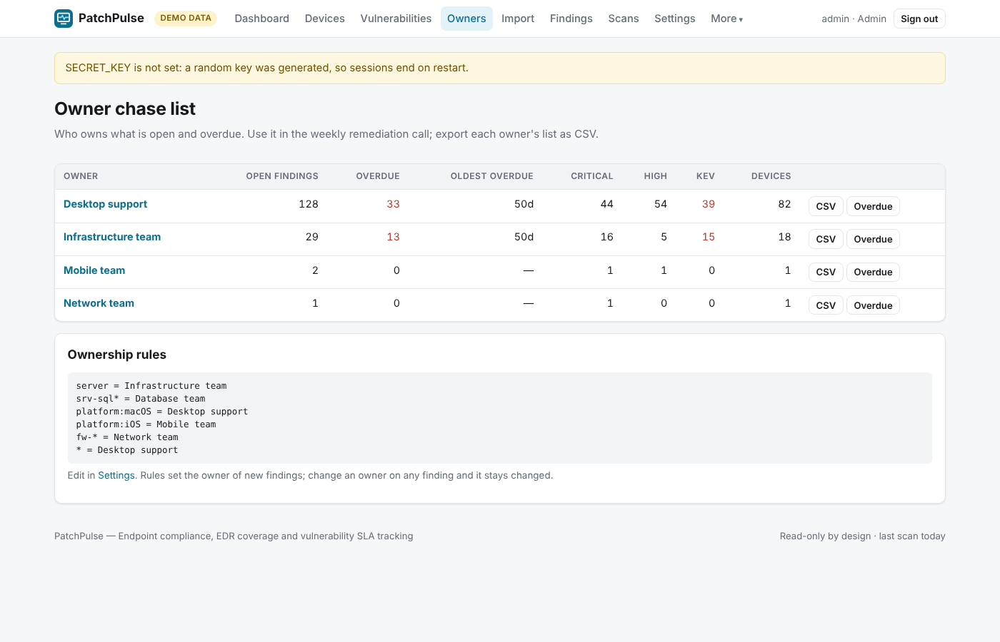

# PatchPulse

**Endpoint compliance, EDR coverage and vulnerability SLA tracking.** PatchPulse joins Microsoft Intune,
CrowdStrike Falcon (hosts + Spotlight) and any scanner's CSV export into one view: what is unpatched,
unprotected or unsupported, who owns it, and whether it is inside your remediation SLA.

[](https://github.com/OWNER/patchpulse/actions/workflows/ci.yml)




## What it does

- **Vulnerability SLA tracking** — every open CVE on every device gets a due date from your SLA. The default
  matches **Cyber Essentials**: high-risk and critical updates (CVSS v3 7.0+) within 14 days. CVEs on the
  **CISA Known Exploited Vulnerabilities** catalogue get their own SLA and can be forced to critical.
- **EDR coverage gaps** — devices in Intune without a Falcon sensor, devices Falcon sees that Intune does not
  manage, stale sensors and sensors in Reduced Functionality Mode.
- **Compliance** — Intune non-compliance, devices not checking in, unencrypted disks, jailbroken phones.
- **OS lifecycle** — Windows 10/11 feature releases and Windows Server past (or near) end of servicing, with
  Pro and Enterprise servicing tracks.
- **Ownership and chasing** — ownership rules (`srv-sql* = Database team`, `platform:macOS = Desktop support`)
  assign every finding; the **Owners** page is your weekly chase list with per-owner CSV exports.
- **Exceptions** — time-limited risk acceptances with justification, which reopen automatically on expiry.
- **Metrics** — SLA compliance %, Cyber Essentials 14-day breaches, mean time to remediate, weekly open trend.
- **Any scanner** — import Nessus/Tenable, Qualys, Rapid7, Defender Vulnerability Management or OpenVAS CSVs;
  columns are auto-detected.



## Detection rules

| Rule | Severity | Category | Detects |
|---|---|---|---|
| `EPC-001` | high | Compliance | **Device not compliant in Intune** — Intune reports the device as non-compliant, in conflict or in error against its compliance policies. |
| `EPC-002` | medium | Compliance | **Device has not checked in to Intune** — The device has not synced with Intune for longer than the threshold, so its policy, patch and compliance state are unknown. |
| `EPC-003` | high | Compliance | **Disk not encrypted** — Intune reports that the device disk is not encrypted (BitLocker/FileVault). A lost device exposes its data. |
| `EPC-004` | high | Lifecycle | **Operating system out of support** — The OS version no longer receives security updates. Cyber Essentials requires in-scope devices to run supported, licensed software. |
| `EPC-005` | medium | Lifecycle | **Operating system support ends soon** — The OS version stops receiving security updates within the warning window. |
| `EPC-006` | high | EDR coverage | **No EDR sensor** — The device is managed by Intune but has no CrowdStrike Falcon sensor, so attacks on it would not be detected or contained. |
| `EPC-007` | medium | EDR coverage | **Device not managed by Intune** — The Falcon sensor sees this device but Intune does not manage it, so compliance and patch policy are not enforced. Common for kiosks, shared PCs and personal devices. |
| `EPC-008` | high | EDR coverage | **EDR sensor not reporting or degraded** — The Falcon sensor has not reported for longer than the threshold or is in Reduced Functionality Mode. |
| `EPC-009` | critical | Compliance | **Jailbroken or rooted mobile device** — Intune reports the device as jailbroken or rooted, which bypasses platform security controls. |
| `VUL-001` | high | Vulnerabilities | **Open vulnerability** — A vulnerability scanner reports an unpatched CVE on the device. The due date comes from your SLA (default: critical and high-risk CVSS ≥ 7 within 14 days, as Cyber Essentials requires; CISA KEV entries use the KEV SLA). |

## Quick start (demo data)

```bash
git clone https://github.com/OWNER/patchpulse.git && cd patchpulse
python -m venv .venv && source .venv/bin/activate     # Windows: .venv\Scripts\activate
pip install -e ".[dev]"
cp .env.example .env
python -m patchpulse serve
```

Open <http://127.0.0.1:8000>, sign in with `admin` / `changeme-demo`. The demo has 168 devices (laptops, Macs,
iPhones, 27 servers, network devices from a Nessus import), Spotlight vulnerabilities and 90 days of remediation history.

Docker: `cp .env.example .env && docker compose up --build`.

## Connect your tools

Each source is optional — use one, two or all three.

**Microsoft Intune** — Entra ID app registration with the **application** permission
`DeviceManagementManagedDevices.Read.All` (admin consent). Set `AZURE_TENANT_ID`, `AZURE_CLIENT_ID`,
`AZURE_CLIENT_SECRET`.

**CrowdStrike Falcon** — *Support and resources → API clients and keys*, create a client with read-only scopes
**Hosts: Read** and **Vulnerabilities: Read**. Set `FALCON_CLIENT_ID`, `FALCON_CLIENT_SECRET` and
`FALCON_BASE_URL` (`us-1`, `us-2`, `eu-1`, `us-gov-1` or a full URL).

**Scanner CSV** — upload on the **Import** page. Required columns: a host (`hostname`, `host`, `asset`, …) and
a CVE (`cve`, `cve_id`, several per cell allowed). Optional: CVSS, severity, title, first seen, product,
remediation.

Then set `DEMO_MODE=false`, `SECRET_KEY` and `ADMIN_PASSWORD`, and run:

```bash
python -m patchpulse check
python -m patchpulse scan
```

Devices are joined across tools on the short host name (case-insensitive, domain suffix removed).
In live mode the CISA KEV feed is downloaded once a day (disable in Settings for air-gapped installs).

## Configuration

| Variable | Default | Purpose |
|---|---|---|
| `DEMO_MODE` | `true` | `false` reads your tools |
| `SECRET_KEY` | random per start | signs session cookies |
| `ADMIN_USERNAME` / `ADMIN_PASSWORD` | `admin` / demo only | administrator sign-in (12+ chars in live mode) |
| `VIEWER_USERNAME` / `VIEWER_PASSWORD` | `auditor` / unset | optional read-only account (e.g. for an assessor) |
| `API_TOKEN` | unset | bearer token for the JSON API |
| `SESSION_COOKIE_SECURE` | `false` | set `true` behind HTTPS |
| `DATABASE_PATH` | `data/patchpulse.db` | SQLite file |
| `SCAN_INTERVAL_HOURS` | `0` | automatic scans |
| `AZURE_*` | — | Intune via Microsoft Graph |
| `FALCON_CLIENT_ID`, `FALCON_CLIENT_SECRET`, `FALCON_BASE_URL` | — | CrowdStrike Falcon |

SLAs, ownership rules, stale thresholds, EDR-required platforms, Windows servicing track and the OS lifecycle
table are in **Settings**.

## Architecture

```
patchpulse/
├── app.py        # product spec and entry point
├── collector.py  # Intune (Graph), Falcon and CSV normalisation, device join, KEV enrichment
├── falcon.py     # read-only CrowdStrike API client (OAuth2, paging, rate limits)
├── catalog.py    # OS lifecycle dates, CVSS → severity, SLA defaults
├── rules.py      # compliance, coverage, lifecycle and SLA rules
├── demo.py       # synthetic estate in API response shapes
├── views.py, templates/
└── core/         # shared web shell, findings lifecycle, Graph client, scanner
```

## Security

Read-only API scopes, strict CSP, CSRF, audit log. See [SECURITY.md](SECURITY.md).

## Development

```bash
pytest -q
ruff check .
```

## Roadmap

- Microsoft Defender for Endpoint as a vulnerability source
- Ticket creation (ServiceNow / Jira) for overdue items
- Patch release dates (rather than first detection) as the SLA start
- Multi-tenant MSP mode and Entra SSO for the web app

## Disclaimer

OS servicing dates are taken from Microsoft's published lifecycle and are editable — verify them, and any
Extended Security Update coverage, for your editions. Cyber Essentials requirements are summarised for
convenience; the NCSC/IASME requirements documents are authoritative.

## Licence

MIT © 2026 Olatunji Kayode Jaiyeola
